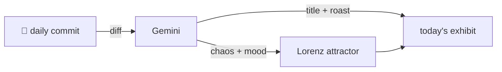

### Hey 👋

I'm Urav. I build things with code.

---

#### 📌 Featured Commit

Every day a bot grabs a commit (one of mine, someone I follow, or a stranger's), an AI names and roasts it, and it ends up as a strange attractor.

<!-- ENTROPY:START -->

### Patterned Paths, Resilient Runs

Chaos ██████░░░░ 65 · Mood $\color{#00BFA5}{\blacksquare}$ #00BFA5

[affaan-m/ECC](https://github.com/affaan-m/ECC) by [@haelyra](https://github.com/haelyra) · [`b38be6a`](https://github.com/affaan-m/ECC/commit/b38be6a7f6350964d59328b52f0624e1d1d552d1)

~~~
Merge pull request #3809 from affaan-m/maint/pr-continuation-20261029

Integrate seven reviewed ECC reliability and guidance fixes
~~~

This commit is a masterclass in hardening and expansion. The explicit `ripgrep` download with SHA256 verification in CI speaks to a well-earned cynicism about dependency stability, a true veteran's move. Additions like the comprehensive `typescript-patterns` skill and the robust tool activity metric filtering show a project thoughtfully investing in both developer guidance and data integrity.

captured 2026-11-02

<!-- ENTROPY:END -->

---

What is this?

 

A GitHub Action runs daily and picks a commit: mine if I've pushed recently, otherwise something from my network or a starred repo, and the Linux genesis commit as a last resort. Gemini gives it a name, a roast, a chaos score (0-100), and a mood color. Those become a [Lorenz attractor](https://en.wikipedia.org/wiki/Lorenz_system): chaos controls how wild the butterfly gets, mood tints the gradient, and the commit hash sets the starting point. The math is identical every run, so the commit is the only thing that changes the picture.

[See the code →](./entropy)

