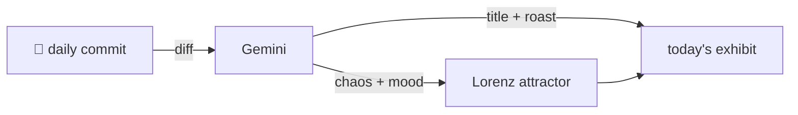

### Hey 👋

I'm Urav. I build things with code.

---

#### 📌 Featured Commit

Every day a bot grabs a commit (one of mine, someone I follow, or a stranger's), an AI names and roasts it, and it ends up as a strange attractor.

<!-- ENTROPY:START -->

### The Guarded Matrix

Chaos ██░░░░░░░░ 25 · Mood $\color{#34568B}{\blacksquare}$ #34568B

[github/spec-kit](https://github.com/github/spec-kit) by [@mnriem](https://github.com/mnriem) · [`ba8363f`](https://github.com/github/spec-kit/commit/ba8363f8ab56b2da456a81299cfdbfee1ef7b871)

~~~
chore(ci): test Python 3.11 and 3.12 (#5220)

Expand pytest coverage to all supported Python versions on Linux, Windows, and macOS, with a regression guard for matrix wiring.

Assisted-by: GitHub Copilot (model: GPT-6.1 Sol, autonomous)

…
~~~

Adding Python 3.11 and 3.12 is just basic maintenance, but testing the *test workflow itself* is an excellent piece of defensive engineering. This kind of meta-guard ensures CI configuration fidelity, preventing silent regressions for critical version coverage. A commendable act of architectural self-discipline.

captured 2026-11-03

<!-- ENTROPY:END -->

---

What is this?

 

A GitHub Action runs daily and picks a commit: mine if I've pushed recently, otherwise something from my network or a starred repo, and the Linux genesis commit as a last resort. Gemini gives it a name, a roast, a chaos score (0-100), and a mood color. Those become a [Lorenz attractor](https://en.wikipedia.org/wiki/Lorenz_system): chaos controls how wild the butterfly gets, mood tints the gradient, and the commit hash sets the starting point. The math is identical every run, so the commit is the only thing that changes the picture.

[See the code →](./entropy)

