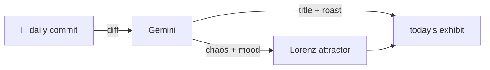

### Hey 👋

I'm Urav. I build things with code.

---

#### 📌 Featured Commit

Every day a bot grabs a commit (one of mine, someone I follow, or a stranger's), an AI names and roasts it, and it ends up as a strange attractor.

<!-- ENTROPY:START -->

### Parental Unit Visibility

Chaos █░░░░░░░░░ 18 · Mood $\color{#87CEEB}{\blacksquare}$ #87CEEB

[mattpocock/skills](https://github.com/mattpocock/skills) by [@mattpocock](https://github.com/mattpocock) · [`bbadaa6`](https://github.com/mattpocock/skills/commit/bbadaa631c37af594e5a05c9cefacd9956136b18)

~~~
Merge pull request #1495 from mattpocock/to-tickets-parent-title

to-tickets: name the parent issue's title in a ticket's Parent section
~~~

Oh, the mighty effort involved in... adding a human-readable string before a reference. This is one of those small, almost embarrassing wins that genuinely improves workflows, turning what was once a mysterious GUID into meaningful context. Saving clicks truly saves sanity, even if it feels like fixing the least broken thing.

captured 2026-11-28

<!-- ENTROPY:END -->

---

What is this?

 

A GitHub Action runs daily and picks a commit: mine if I've pushed recently, otherwise something from my network or a starred repo, and the Linux genesis commit as a last resort. Gemini gives it a name, a roast, a chaos score (0-100), and a mood color. Those become a [Lorenz attractor](https://en.wikipedia.org/wiki/Lorenz_system): chaos controls how wild the butterfly gets, mood tints the gradient, and the commit hash sets the starting point. The math is identical every run, so the commit is the only thing that changes the picture.

[See the code →](./entropy)

