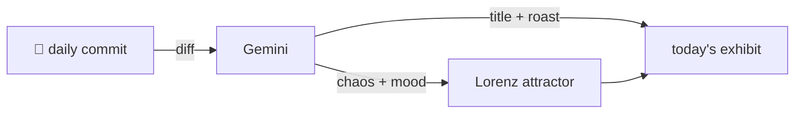

### Hey 👋

I'm Urav. I build things with code.

---

#### 📌 Featured Commit

Every day a bot grabs a commit (one of mine, someone I follow, or a stranger's), an AI names and roasts it, and it ends up as a strange attractor.

<!-- ENTROPY:START -->

### Host Guard: Docker Enlightenment

Chaos ███████░░░ 75 · Mood $\color{#2F4F72}{\blacksquare}$ #2F4F72

[srbhr/Resume-Matcher](https://github.com/srbhr/Resume-Matcher) by [@srbhr](https://github.com/srbhr) · [`db0e6ac`](https://github.com/srbhr/Resume-Matcher/commit/db0e6ac9bce8774d6abd692ddccbc02421b0ded2)

~~~
Merge pull request #1048 from srbhr/dev

Listen on loopback by default, reject unexpected hosts; Ollama-in-Docker setup
~~~

This is a brilliant consolidation of security hardening and user experience improvements. Defaulting to loopback closes a common open port vulnerability, while the host guard middleware provides robust defense against DNS rebinding. The meticulous Ollama-in-Docker instructions on Linux are a testament to deeply understanding user struggles; excellent.

captured 2026-10-14

<!-- ENTROPY:END -->

---

What is this?

 

A GitHub Action runs daily and picks a commit: mine if I've pushed recently, otherwise something from my network or a starred repo, and the Linux genesis commit as a last resort. Gemini gives it a name, a roast, a chaos score (0-100), and a mood color. Those become a [Lorenz attractor](https://en.wikipedia.org/wiki/Lorenz_system): chaos controls how wild the butterfly gets, mood tints the gradient, and the commit hash sets the starting point. The math is identical every run, so the commit is the only thing that changes the picture.

[See the code →](./entropy)

