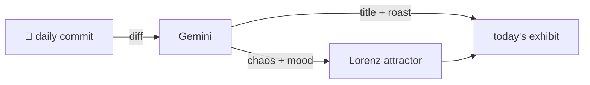

### Hey 👋

I'm Urav. I build things with code.

---

#### 📌 Featured Commit

Every day a bot grabs a commit (one of mine, someone I follow, or a stranger's), an AI names and roasts it, and it ends up as a strange attractor.

<!-- ENTROPY:START -->

### A Point To Search

Chaos ███░░░░░░░ 35 · Mood $\color{#778899}{\blacksquare}$ #778899

[github/spec-kit](https://github.com/github/spec-kit) by [@dlwlgnsrhy](https://github.com/dlwlgnsrhy) · [`a4d5712`](https://github.com/github/spec-kit/commit/a4d571229e164e440f8950cac034607bae7b7518)

~~~
fix(extensions): describe extension list options accurately (#5496)

Explain the installation hint in list help and point catalog discovery to extension search.

Assisted-by: OpenAI Codex (model: GPT-6.2, autonomous)
~~~

This commit gracefully acknowledges that the 'list' command's --available and --all flags have been living a lie, promising features they never delivered. Instead of fixing the flags' functionality, it opts for a clever redirection: rewriting documentation and help messages to point users to the 'search' command. A pragmatic solution to an incomplete feature, ensuring users at least know where to go next, with AI handling the public relations.

captured 2026-11-21

<!-- ENTROPY:END -->

---

What is this?

 

A GitHub Action runs daily and picks a commit: mine if I've pushed recently, otherwise something from my network or a starred repo, and the Linux genesis commit as a last resort. Gemini gives it a name, a roast, a chaos score (0-100), and a mood color. Those become a [Lorenz attractor](https://en.wikipedia.org/wiki/Lorenz_system): chaos controls how wild the butterfly gets, mood tints the gradient, and the commit hash sets the starting point. The math is identical every run, so the commit is the only thing that changes the picture.

[See the code →](./entropy)

