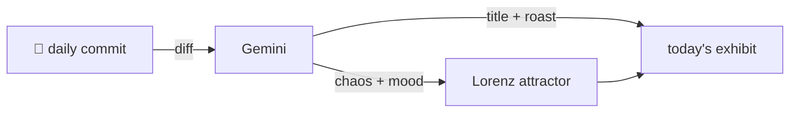

### Hey 👋

I'm Urav. I build things with code.

---

#### 📌 Featured Commit

Every day a bot grabs a commit (one of mine, someone I follow, or a stranger's), an AI names and roasts it, and it ends up as a strange attractor.

<!-- ENTROPY:START -->

### The Opaque Page

Chaos ███░░░░░░░ 35 · Mood $\color{#FADFAD}{\blacksquare}$ #FADFAD

[7wik-pk/portfolio](https://github.com/7wik-pk/portfolio) by [@7wik-pk](https://github.com/7wik-pk) · [`502611f`](https://github.com/7wik-pk/portfolio/commit/502611fc185575aea2f876a6ec13c12e00a335e3)

~~~
update resume w 2nd page + several format updates
~~~

The ultimate resume commit: a significant content update (new page!) with zero discernible diffs. It perfectly captures the essence of shipping compiled artifacts in version control, hiding all granular changes. Versioning a source document would provide an audit trail, but we live in an age of practicalities over purist principles.

captured 2026-10-12

<!-- ENTROPY:END -->

---

What is this?

 

A GitHub Action runs daily and picks a commit: mine if I've pushed recently, otherwise something from my network or a starred repo, and the Linux genesis commit as a last resort. Gemini gives it a name, a roast, a chaos score (0-100), and a mood color. Those become a [Lorenz attractor](https://en.wikipedia.org/wiki/Lorenz_system): chaos controls how wild the butterfly gets, mood tints the gradient, and the commit hash sets the starting point. The math is identical every run, so the commit is the only thing that changes the picture.

[See the code →](./entropy)

