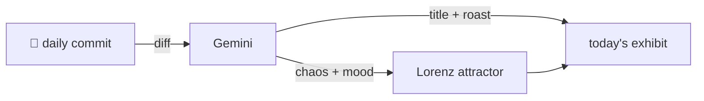

### Hey 👋

I'm Urav. I build things with code.

---

#### 📌 Featured Commit

Every day a bot grabs a commit (one of mine, someone I follow, or a stranger's), an AI names and roasts it, and it ends up as a strange attractor.

<!-- ENTROPY:START -->

### Factory System Blueprints

Chaos ███████░░░ 75 · Mood $\color{#0A3C52}{\blacksquare}$ #0A3C52

[mattpocock/skills](https://github.com/mattpocock/skills) by [@mattpocock](https://github.com/mattpocock) · [`4ae2317`](https://github.com/mattpocock/skills/commit/4ae2317ddb22b046e26455e4f9c9b3aaaf62212d)

~~~
software-factory: glossary skill for designing a factory (#1316)

* software-factory: add glossary skill for designing a factory

Co-Authored-By: Claude Opus 5.5 <noreply@anthropic.com>

…
~~~

This isn't merely a 'skill'; it's an entire operational philosophy, outlining the blueprint for what 'software factory' design *should* be. The meticulous framework, detailed service surveys, and emphasis on 'brakes' demonstrate a shrewd foresight for AI-orchestrated development. And yes, those 'surveyed 2026-10' dates with Claude Opus 5.5 as co-author aren't subtle—they're either audacious genius or impeccably transparent ghostwriting, producing a future artifact today.

captured 2026-11-01

<!-- ENTROPY:END -->

---

What is this?

 

A GitHub Action runs daily and picks a commit: mine if I've pushed recently, otherwise something from my network or a starred repo, and the Linux genesis commit as a last resort. Gemini gives it a name, a roast, a chaos score (0-100), and a mood color. Those become a [Lorenz attractor](https://en.wikipedia.org/wiki/Lorenz_system): chaos controls how wild the butterfly gets, mood tints the gradient, and the commit hash sets the starting point. The math is identical every run, so the commit is the only thing that changes the picture.

[See the code →](./entropy)

