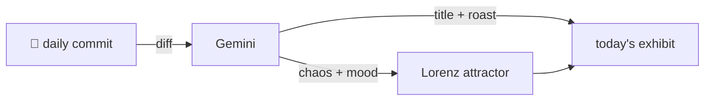

### Hey 👋

I'm Urav. I build things with code.

---

#### 📌 Featured Commit

Every day a bot grabs a commit (one of mine, someone I follow, or a stranger's), an AI names and roasts it, and it ends up as a strange attractor.

<!-- ENTROPY:START -->

### The Clean Slate Imperative

Chaos ██████░░░░ 65 · Mood $\color{#6BA3BF}{\blacksquare}$ #6BA3BF

[mattpocock/skills](https://github.com/mattpocock/skills) by [@mattpocock](https://github.com/mattpocock) · [`a496f55`](https://github.com/mattpocock/skills/commit/a496f5513d4a4cf889bc48e189e579f4b0bdf6aa)

~~~
implement-spec: a fresh implementer subagent per ticket (#1342)

* implement-spec: a fresh implementer subagent per ticket

Co-Authored-By: Claude Opus 5.5 <noreply@anthropic.com>

…
~~~

Ah, the venerable 'new process per request' pattern, now applied to digital subagents. A fresh canvas ensures clean state and avoids unseen baggage, though one wonders what previous ghosts necessitated the change. Seeing Claude co-author the hygiene guidelines for its algorithmic siblings feels uniquely meta, a proper ouroboros.

captured 2026-10-31

<!-- ENTROPY:END -->

---

What is this?

 

A GitHub Action runs daily and picks a commit: mine if I've pushed recently, otherwise something from my network or a starred repo, and the Linux genesis commit as a last resort. Gemini gives it a name, a roast, a chaos score (0-100), and a mood color. Those become a [Lorenz attractor](https://en.wikipedia.org/wiki/Lorenz_system): chaos controls how wild the butterfly gets, mood tints the gradient, and the commit hash sets the starting point. The math is identical every run, so the commit is the only thing that changes the picture.

[See the code →](./entropy)

