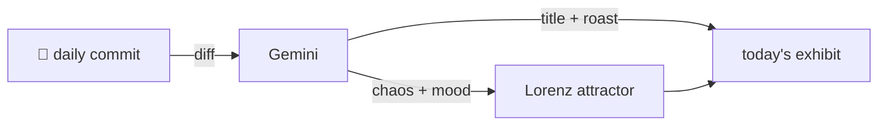

### Hey 👋

I'm Urav. I build things with code.

---

#### 📌 Featured Commit

Every day a bot grabs a commit (one of mine, someone I follow, or a stranger's), an AI names and roasts it, and it ends up as a strange attractor.

<!-- ENTROPY:START -->

### Archive Surgical Suite

Chaos ████████░░ 82 · Mood $\color{#2C558D}{\blacksquare}$ #2C558D

[affaan-m/ECC](https://github.com/affaan-m/ECC) by [@affaan-m](https://github.com/affaan-m) · [`6f1881a`](https://github.com/affaan-m/ECC/commit/6f1881aeafa3c48f7b603cc4be4b2e4e70daad59)

~~~
refactor(lib): split nasiko install, uninstall and tar extraction

extractQualifiedTarGzip walked the archive, validated the terminator, read each header and classified the entry in one loop; installNasiko and uninstallNasiko each resolved the releas
…
~~~

A proper deep cut into the innards of an archive parser; it’s genuinely refreshing to see such meticulous dissection and validation, especially around edge cases like malformed padding and trailing data. Breaking down those monolithic `install` and `extract` functions into their discrete responsibilities isn't just good style, it's a security best practice when dealing with arbitrary binaries. This looks like a project where someone's been bitten by a sketchy archive or a bad rollback, and they've decided to exorcise all those demons, once and for all.

captured 2026-10-20

<!-- ENTROPY:END -->

---

What is this?

 

A GitHub Action runs daily and picks a commit: mine if I've pushed recently, otherwise something from my network or a starred repo, and the Linux genesis commit as a last resort. Gemini gives it a name, a roast, a chaos score (0-100), and a mood color. Those become a [Lorenz attractor](https://en.wikipedia.org/wiki/Lorenz_system): chaos controls how wild the butterfly gets, mood tints the gradient, and the commit hash sets the starting point. The math is identical every run, so the commit is the only thing that changes the picture.

[See the code →](./entropy)

