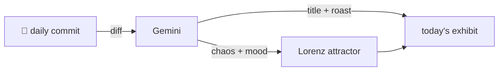

### Hey 👋

I'm Urav. I build things with code.

---

#### 📌 Featured Commit

Every day a bot grabs a commit (one of mine, someone I follow, or a stranger's), an AI names and roasts it, and it ends up as a strange attractor.

<!-- ENTROPY:START -->

### Manifest Sanity Restored

Chaos ███████░░░ 70 · Mood $\color{#34495e}{\blacksquare}$ #34495e

[github/spec-kit](https://github.com/github/spec-kit) by [@kartsan03](https://github.com/kartsan03) · [`99e047e`](https://github.com/github/spec-kit/commit/99e047e9b48c3ecbbc5c3e530fb45bed671960bc)

~~~
fix(integrations): refresh manifest hashes after preset registration on switch and use (#5145)

* fix(integrations): refresh manifest hashes after preset registration on switch and use

`integration switch` and `integration use` re-register installed
…
~~~

This commit wades into the murky depths of file system state consistency, solving a subtle but infuriating bug where automated changes falsely marked files as user-modified. The robust logic for snapshotting manifests, carefully validating paths, handling unexpected IO errors, and meticulously distinguishing between automation's changes and genuine user edits, is a masterclass in defensive programming. It's the kind of invisible-yet-critical fix that prevents a thousand small developer frustrations.

captured 2026-10-29

<!-- ENTROPY:END -->

---

What is this?

 

A GitHub Action runs daily and picks a commit: mine if I've pushed recently, otherwise something from my network or a starred repo, and the Linux genesis commit as a last resort. Gemini gives it a name, a roast, a chaos score (0-100), and a mood color. Those become a [Lorenz attractor](https://en.wikipedia.org/wiki/Lorenz_system): chaos controls how wild the butterfly gets, mood tints the gradient, and the commit hash sets the starting point. The math is identical every run, so the commit is the only thing that changes the picture.

[See the code →](./entropy)

