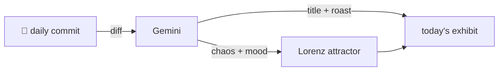

### Hey 👋

I'm Urav. I build things with code.

---

#### 📌 Featured Commit

Every day a bot grabs a commit (one of mine, someone I follow, or a stranger's), an AI names and roasts it, and it ends up as a strange attractor.

<!-- ENTROPY:START -->

### Zeroth Blueprint Laid

Chaos ██████████ 100 · Mood $\color{#2ECC40}{\blacksquare}$ #2ECC40

[7wik-pk/zeroth-responder-ai](https://github.com/7wik-pk/zeroth-responder-ai) by [@7wik-pk](https://github.com/7wik-pk) · [`2f64ecd`](https://github.com/7wik-pk/zeroth-responder-ai/commit/2f64ecdaba0a203cafa3461639bcb3bd0ecbcabc)

~~~
init commit
~~~

This initial commit is less of a kick-off and more of a meticulously pre-flighted mission statement, complete with architecture diagrams and an implementation plan. The decision to use LiteLLM for multi-provider orchestration and implement in-process embeddings shows smart, future-proof planning, especially given the strict data handling requirements for healthcare. It's a remarkably robust start, demonstrating clarity and foresight where many projects just begin coding.

captured 2026-10-13

<!-- ENTROPY:END -->

---

What is this?

 

A GitHub Action runs daily and picks a commit: mine if I've pushed recently, otherwise something from my network or a starred repo, and the Linux genesis commit as a last resort. Gemini gives it a name, a roast, a chaos score (0-100), and a mood color. Those become a [Lorenz attractor](https://en.wikipedia.org/wiki/Lorenz_system): chaos controls how wild the butterfly gets, mood tints the gradient, and the commit hash sets the starting point. The math is identical every run, so the commit is the only thing that changes the picture.

[See the code →](./entropy)

