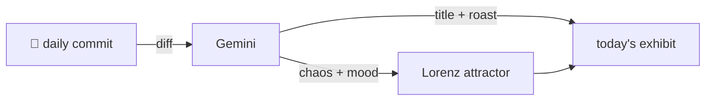

### Hey 👋

I'm Urav. I build things with code.

---

#### 📌 Featured Commit

Every day a bot grabs a commit (one of mine, someone I follow, or a stranger's), an AI names and roasts it, and it ends up as a strange attractor.

<!-- ENTROPY:START -->

### Claude Models & Reality Check

Chaos ███████░░░ 70 · Mood $\color{#563D7E}{\blacksquare}$ #563D7E

[srbhr/Resume-Matcher](https://github.com/srbhr/Resume-Matcher) by [@srbhr](https://github.com/srbhr) · [`a8fd5c4`](https://github.com/srbhr/Resume-Matcher/commit/a8fd5c4a9af0b1d8b4439b4dcb1c4cacd034f132)

~~~
Merge pull request #1053 from srbhr/dev

Release: Claude Code model picker and subscription risk dialog (#1052)
~~~

A very robust release. Offering granular model choice for Claude's CLI users is a nice bump in utility, and the clear risk disclosure for subscription-based services is a masterclass in responsible engineering. The depth of internationalization also truly stands out.

captured 2026-10-16

<!-- ENTROPY:END -->

---

What is this?

 

A GitHub Action runs daily and picks a commit: mine if I've pushed recently, otherwise something from my network or a starred repo, and the Linux genesis commit as a last resort. Gemini gives it a name, a roast, a chaos score (0-100), and a mood color. Those become a [Lorenz attractor](https://en.wikipedia.org/wiki/Lorenz_system): chaos controls how wild the butterfly gets, mood tints the gradient, and the commit hash sets the starting point. The math is identical every run, so the commit is the only thing that changes the picture.

[See the code →](./entropy)

