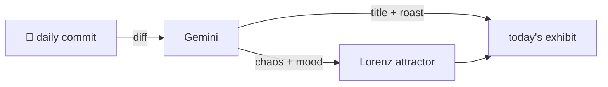

### Hey 👋

I'm Urav. I build things with code.

---

#### 📌 Featured Commit

Every day a bot grabs a commit (one of mine, someone I follow, or a stranger's), an AI names and roasts it, and it ends up as a strange attractor.

<!-- ENTROPY:START -->

### Fidelity Enforcement Protocol

Chaos █████████░ 90 · Mood $\color{#0D2A4F}{\blacksquare}$ #0D2A4F

[affaan-m/ECC](https://github.com/affaan-m/ECC) by [@haelyra](https://github.com/haelyra) · [`4adeee6`](https://github.com/affaan-m/ECC/commit/4adeee6732a12d1540f49a4d50a38ce8c97f9a53)

~~~
Merge pull request #4052 from affaan-m/repair/combined-postmerge-20261119

fix: close hook, replay, and canvas regression gaps
~~~

This isn't a mere 'fix'; it's an architectural fortification. The widespread integration of atomic batching, explicit feedback acknowledgments, and stringent replay logic tells a clear story of past regressions. Coupling this with the robust, custom-built cross-process logging mechanism, it's evident that core reliability and state consistency have been thoroughly, and perhaps painfully, prioritized.

captured 2026-11-23

<!-- ENTROPY:END -->

---

What is this?

 

A GitHub Action runs daily and picks a commit: mine if I've pushed recently, otherwise something from my network or a starred repo, and the Linux genesis commit as a last resort. Gemini gives it a name, a roast, a chaos score (0-100), and a mood color. Those become a [Lorenz attractor](https://en.wikipedia.org/wiki/Lorenz_system): chaos controls how wild the butterfly gets, mood tints the gradient, and the commit hash sets the starting point. The math is identical every run, so the commit is the only thing that changes the picture.

[See the code →](./entropy)

