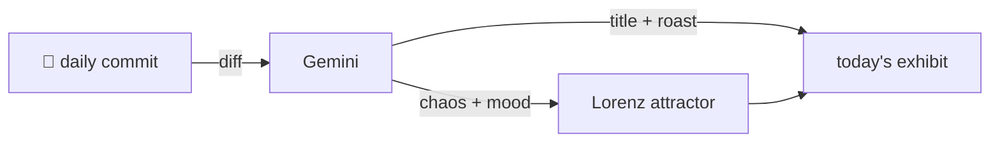

### Hey 👋

I'm Urav. I build things with code.

---

#### 📌 Featured Commit

Every day a bot grabs a commit (one of mine, someone I follow, or a stranger's), an AI names and roasts it, and it ends up as a strange attractor.

<!-- ENTROPY:START -->

### The Comprehensive Blueprint

Chaos █████████░ 90 · Mood $\color{#2C3E50}{\blacksquare}$ #2C3E50

[srbhr/Resume-Matcher](https://github.com/srbhr/Resume-Matcher) by [@srbhr](https://github.com/srbhr) · [`58350ea`](https://github.com/srbhr/Resume-Matcher/commit/58350ea6344e162689708826f033d3ec898d17d8)

~~~
Release: promote dev to main (#1042)

Release: promote dev to main (contributor PRs, MCP server, ATS check, subscription sign-in, community links)
~~~

This release commit is an impressive, near-total foundational overhaul. It refines the design system into an almost immutable doctrine, swaps out the database backend, integrates several complex LLM providers, and adds a major feature all at once. The extensive documentation and cross-platform setup guides demonstrate a thoroughness that's as commendable as it is ambitious for a single merge.

captured 2026-10-11

<!-- ENTROPY:END -->

---

What is this?

 

A GitHub Action runs daily and picks a commit: mine if I've pushed recently, otherwise something from my network or a starred repo, and the Linux genesis commit as a last resort. Gemini gives it a name, a roast, a chaos score (0-100), and a mood color. Those become a [Lorenz attractor](https://en.wikipedia.org/wiki/Lorenz_system): chaos controls how wild the butterfly gets, mood tints the gradient, and the commit hash sets the starting point. The math is identical every run, so the commit is the only thing that changes the picture.

[See the code →](./entropy)

