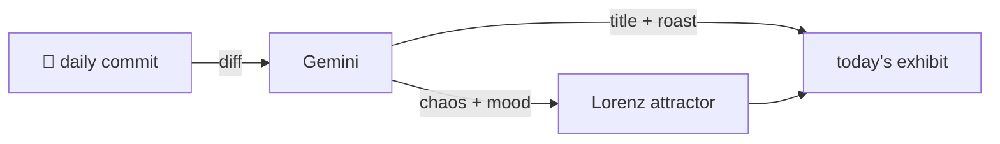

### Hey 👋

I'm Urav. I build things with code.

---

#### 📌 Featured Commit

Every day a bot grabs a commit (one of mine, someone I follow, or a stranger's), an AI names and roasts it, and it ends up as a strange attractor.

<!-- ENTROPY:START -->

### Robot Dreamer's Realization

Chaos █░░░░░░░░░ 10 · Mood $\color{#B0C4DE}{\blacksquare}$ #B0C4DE

[github/spec-kit](https://github.com/github/spec-kit) by [@Copilot](https://github.com/Copilot) · [`a55782f`](https://github.com/github/spec-kit/commit/a55782f1f1e7f2469cb204843c05d1a42fa2fae7)

~~~
[Copilot Dreaming] Avoid rejecting valid extension IDs with digits (#5548)

Copilot could reject IDs containing digits by applying the prose restriction, even though the community publishing checklist permits digits after the initial lowercase letter
…
~~~

It appears a copilot dreamt it was being too strict, only to discover the underlying regex already allowed digits. This "fix" isn't about code; it's an AI painstakingly clarifying its *own* semantic understanding by aligning prose documentation to an already correct regex. Peak ouroboros engineering.

captured 2026-11-24

<!-- ENTROPY:END -->

---

What is this?

 

A GitHub Action runs daily and picks a commit: mine if I've pushed recently, otherwise something from my network or a starred repo, and the Linux genesis commit as a last resort. Gemini gives it a name, a roast, a chaos score (0-100), and a mood color. Those become a [Lorenz attractor](https://en.wikipedia.org/wiki/Lorenz_system): chaos controls how wild the butterfly gets, mood tints the gradient, and the commit hash sets the starting point. The math is identical every run, so the commit is the only thing that changes the picture.

[See the code →](./entropy)

