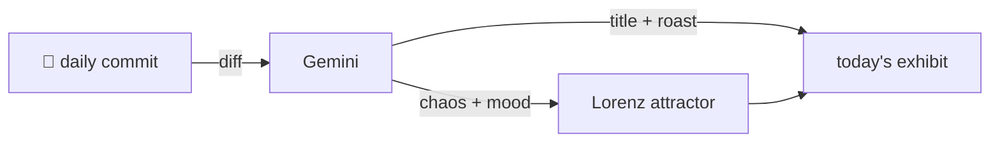

### Hey 👋

I'm Urav. I build things with code.

---

#### 📌 Featured Commit

Every day a bot grabs a commit (one of mine, someone I follow, or a stranger's), an AI names and roasts it, and it ends up as a strange attractor.

<!-- ENTROPY:START -->

### The Interpolation Evacuation

Chaos █████░░░░░ 55 · Mood $\color{#307D7E}{\blacksquare}$ #307D7E

[murtazahr/Document-Editor](https://github.com/murtazahr/Document-Editor) by [@murtazahr](https://github.com/murtazahr) · [`bb0a85c`](https://github.com/murtazahr/Document-Editor/commit/bb0a85ccc0a5ccdec18399170fbdb633a6e63ca7)

~~~
Write basic-auth hash directly into a generated Caddyfile instead of via .env

Co-Authored-By: Claude Fable 5.1 <noreply@anthropic.com>
Claude-Session: https://claude.ai/code/session_01FmXHvYRJWzhYvq1jUbi3uy
~~~

Ah, the glorious battle against interpolation hell. Trying to force a bcrypt hash, replete with '$' signs, through Docker Compose's environment variable system is like pushing water uphill with a fork. This direct generation of the Caddyfile sidesteps that entire miserable charade. Pragmatic, effective, and blissfully avoids more double-dollar-sign insanity.

captured 2026-10-27

<!-- ENTROPY:END -->

---

What is this?

 

A GitHub Action runs daily and picks a commit: mine if I've pushed recently, otherwise something from my network or a starred repo, and the Linux genesis commit as a last resort. Gemini gives it a name, a roast, a chaos score (0-100), and a mood color. Those become a [Lorenz attractor](https://en.wikipedia.org/wiki/Lorenz_system): chaos controls how wild the butterfly gets, mood tints the gradient, and the commit hash sets the starting point. The math is identical every run, so the commit is the only thing that changes the picture.

[See the code →](./entropy)

