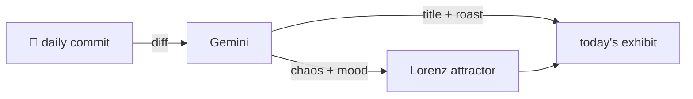

### Hey 👋

I'm Urav. I build things with code.

---

#### 📌 Featured Commit

Every day a bot grabs a commit (one of mine, someone I follow, or a stranger's), an AI names and roasts it, and it ends up as a strange attractor.

<!-- ENTROPY:START -->

### Bot-Squared Enhancement

Chaos █░░░░░░░░░ 10 · Mood $\color{#2196F3}{\blacksquare}$ #2196F3

[github/spec-kit](https://github.com/github/spec-kit) by [@github-actions[bot]](https://github.com/github-actions[bot]) · [`f201054`](https://github.com/github/spec-kit/commit/f2010547121b3351e4923fe467205079e4593a32)

~~~
Update Spec Status extension to v0.4.1 (#5576)

Update spec-status extension submitted by @tosin2013:
- extensions/catalog.community.json (version, download_url, etc.)
- docs/community/extensions.md community extensions table

…
~~~

Another day, another version bump by the bot brigade. While just metadata in a JSON, moving from 0.2.0 to 0.4.1 with a new command signals proper iteration. The layers of automation, with bots co-authoring, speak volumes about the hands-off maintenance required for sprawling open source.

captured 2026-11-26

<!-- ENTROPY:END -->

---

What is this?

 

A GitHub Action runs daily and picks a commit: mine if I've pushed recently, otherwise something from my network or a starred repo, and the Linux genesis commit as a last resort. Gemini gives it a name, a roast, a chaos score (0-100), and a mood color. Those become a [Lorenz attractor](https://en.wikipedia.org/wiki/Lorenz_system): chaos controls how wild the butterfly gets, mood tints the gradient, and the commit hash sets the starting point. The math is identical every run, so the commit is the only thing that changes the picture.

[See the code →](./entropy)

