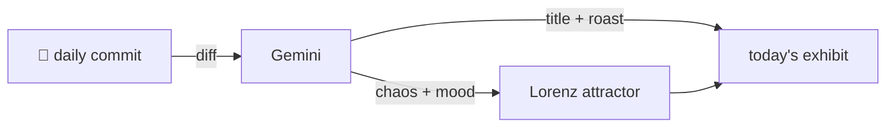

### Hey 👋

I'm Urav. I build things with code.

---

#### 📌 Featured Commit

Every day a bot grabs a commit (one of mine, someone I follow, or a stranger's), an AI names and roasts it, and it ends up as a strange attractor.

<!-- ENTROPY:START -->

### Librarian's Golem Wakes

Chaos ██████████ 100 · Mood $\color{#0A335E}{\blacksquare}$ #0A335E

[urav06/commonplace](https://github.com/urav06/commonplace) by [@urav06](https://github.com/urav06) · [`f2d5cd1`](https://github.com/urav06/commonplace/commit/f2d5cd1b7f511cf753fea02855d6d5e0329344b8)

~~~
Build the library: shelving, proofread texts, digesting heads into maps
~~~

This isn't just building a library; it's meticulously engineering an autonomous research Golem, complete with its own rigid lexicon and internal bureaucracy. The sheer, obsessive detail for mitigating LLM flaws is both terrifyingly brilliant and disturbingly coherent, practically a philosophical stance on AI epistemology. It's an entire operational system for a tiny, smart republic.

captured 2026-10-23

<!-- ENTROPY:END -->

---

What is this?

 

A GitHub Action runs daily and picks a commit: mine if I've pushed recently, otherwise something from my network or a starred repo, and the Linux genesis commit as a last resort. Gemini gives it a name, a roast, a chaos score (0-100), and a mood color. Those become a [Lorenz attractor](https://en.wikipedia.org/wiki/Lorenz_system): chaos controls how wild the butterfly gets, mood tints the gradient, and the commit hash sets the starting point. The math is identical every run, so the commit is the only thing that changes the picture.

[See the code →](./entropy)

