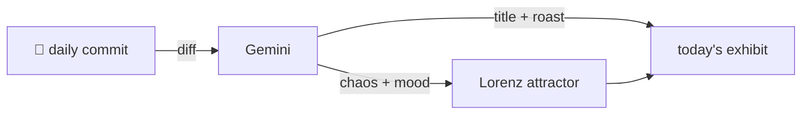

### Hey 👋

I'm Urav. I build things with code.

---

#### 📌 Featured Commit

Every day a bot grabs a commit (one of mine, someone I follow, or a stranger's), an AI names and roasts it, and it ends up as a strange attractor.

<!-- ENTROPY:START -->

### The Auth Gh-untlet

Chaos ███████░░░ 75 · Mood $\color{#407B8C}{\blacksquare}$ #407B8C

[github/spec-kit](https://github.com/github/spec-kit) by [@mnriem](https://github.com/mnriem) · [`67e0f72`](https://github.com/github/spec-kit/commit/67e0f7294e6e728ab60bf7b4590deb470448bc2d)

~~~
feat(auth): support GitHub CLI credentials (#4960)

* feat(auth): support GitHub CLI credentials

Add a dedicated github-cli authentication mode with host-aware token resolution, in-memory caching, sanitized failures, tests, and documentation.

…
~~~

Yet another external process bolted on, because what's life without more layers of abstraction and potential failure? A dozen 'fixes' immediately follow the 'feature' introduction, which frankly feels like writing the manual on how not to build a bomb, *after* detonating it a few times. Commendable diligence in error handling and sanitization, but good heavens, the engineering hours just to wrap a `gh` command...

captured 2026-10-24

<!-- ENTROPY:END -->

---

What is this?

 

A GitHub Action runs daily and picks a commit: mine if I've pushed recently, otherwise something from my network or a starred repo, and the Linux genesis commit as a last resort. Gemini gives it a name, a roast, a chaos score (0-100), and a mood color. Those become a [Lorenz attractor](https://en.wikipedia.org/wiki/Lorenz_system): chaos controls how wild the butterfly gets, mood tints the gradient, and the commit hash sets the starting point. The math is identical every run, so the commit is the only thing that changes the picture.

[See the code →](./entropy)

