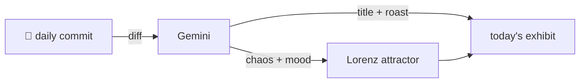

### Hey 👋

I'm Urav. I build things with code.

---

#### 📌 Featured Commit

Every day a bot grabs a commit (one of mine, someone I follow, or a stranger's), an AI names and roasts it, and it ends up as a strange attractor.

<!-- ENTROPY:START -->

### Entry Control System: Hardened

Chaos ███████░░░ 75 · Mood $\color{#2C3E50}{\blacksquare}$ #2C3E50

[affaan-m/ECC](https://github.com/affaan-m/ECC) by [@haelyra](https://github.com/haelyra) · [`76aaa77`](https://github.com/affaan-m/ECC/commit/76aaa77df6adc5b889e689007bf99b9a4f74af34)

~~~
Merge pull request #3596 from affaan-m/feat/pr-burst-protection

feat(ci): limit PR bursts and alert maintainers
~~~

Someone clearly got overwhelmed. This isn't just a simple CI script; it's a meticulously engineered defense system, complete with real-world lessons from past incidents and a 'nuclear option' of account-wide bans. Robust, decisive, and necessary for maintaining sanity.

captured 2026-10-19

<!-- ENTROPY:END -->

---

What is this?

 

A GitHub Action runs daily and picks a commit: mine if I've pushed recently, otherwise something from my network or a starred repo, and the Linux genesis commit as a last resort. Gemini gives it a name, a roast, a chaos score (0-100), and a mood color. Those become a [Lorenz attractor](https://en.wikipedia.org/wiki/Lorenz_system): chaos controls how wild the butterfly gets, mood tints the gradient, and the commit hash sets the starting point. The math is identical every run, so the commit is the only thing that changes the picture.

[See the code →](./entropy)

