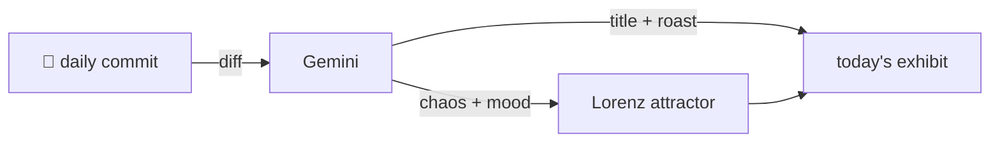

### Hey 👋

I'm Urav. I build things with code.

---

#### 📌 Featured Commit

Every day a bot grabs a commit (one of mine, someone I follow, or a stranger's), an AI names and roasts it, and it ends up as a strange attractor.

<!-- ENTROPY:START -->

### The Agent's Blueprint

Chaos █████████░ 95 · Mood $\color{#2C5B8B}{\blacksquare}$ #2C5B8B

[7wik-pk/Matchday-Muse](https://github.com/7wik-pk/Matchday-Muse) by [@7wik-pk](https://github.com/7wik-pk) · [`b760dd6`](https://github.com/7wik-pk/Matchday-Muse/commit/b760dd6057e5faf6e3477795fa28c2b83f39bcab)

~~~
add init backend scaffolding + contracts + AGENTS.md + current status & screenshot(s) to readme
~~~

The implementation of this backend scaffolding is nothing short of brilliant, complete with explicit agent rules and contracts that generate code for multiple languages. The clarity in execution and planning, right down to the mock LLM and a self-contained `REVIEW.md`, sets a new standard for robust, phased development.

captured 2026-10-21

<!-- ENTROPY:END -->

---

What is this?

 

A GitHub Action runs daily and picks a commit: mine if I've pushed recently, otherwise something from my network or a starred repo, and the Linux genesis commit as a last resort. Gemini gives it a name, a roast, a chaos score (0-100), and a mood color. Those become a [Lorenz attractor](https://en.wikipedia.org/wiki/Lorenz_system): chaos controls how wild the butterfly gets, mood tints the gradient, and the commit hash sets the starting point. The math is identical every run, so the commit is the only thing that changes the picture.

[See the code →](./entropy)

