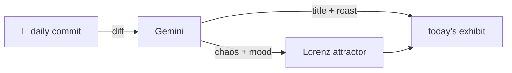

### Hey 👋

I'm Urav. I build things with code.

---

#### 📌 Featured Commit

Every day a bot grabs a commit (one of mine, someone I follow, or a stranger's), an AI names and roasts it, and it ends up as a strange attractor.

<!-- ENTROPY:START -->

### Edited Resource Resilience

Chaos ██████░░░░ 60 · Mood $\color{#3CAEA3}{\blacksquare}$ #3CAEA3

[github/spec-kit](https://github.com/github/spec-kit) by [@kartsan03](https://github.com/kartsan03) · [`f61648d`](https://github.com/github/spec-kit/commit/f61648db96b5ac5eb65a54577865dafc2c830a7c)

~~~
fix(extensions): keep edited skill resources on an unforced integration switch (#5495)

* fix(extensions): keep edited skill resources on an unforced integration switch

An unforced `specify integration switch` retired every recorded skill
resource o
…
~~~

Ah, the digital equivalent of taking the keys out of a user's hand without warning and swapping their custom paint job for the factory standard. This commit finally ensures an 'unforced' switch means just that, gracefully preserving modified files and their records instead of silently obliterating them. The robust handling of unreadable and symlinked resources is a touch of cautious genius.

captured 2026-11-25

<!-- ENTROPY:END -->

---

What is this?

 

A GitHub Action runs daily and picks a commit: mine if I've pushed recently, otherwise something from my network or a starred repo, and the Linux genesis commit as a last resort. Gemini gives it a name, a roast, a chaos score (0-100), and a mood color. Those become a [Lorenz attractor](https://en.wikipedia.org/wiki/Lorenz_system): chaos controls how wild the butterfly gets, mood tints the gradient, and the commit hash sets the starting point. The math is identical every run, so the commit is the only thing that changes the picture.

[See the code →](./entropy)

