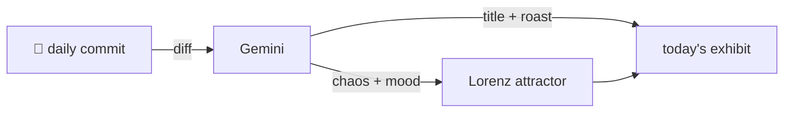

### Hey 👋

I'm Urav. I build things with code.

---

#### 📌 Featured Commit

Every day a bot grabs a commit (one of mine, someone I follow, or a stranger's), an AI names and roasts it, and it ends up as a strange attractor.

<!-- ENTROPY:START -->

### Remarkable Boundaries

Chaos ██████░░░░ 68 · Mood $\color{#2B587D}{\blacksquare}$ #2B587D

[github/spec-kit](https://github.com/github/spec-kit) by [@kartsan03](https://github.com/kartsan03) · [`222a973`](https://github.com/github/spec-kit/commit/222a973f8b8794366680c043fb935a31f71902af)

~~~
fix(vibe): keep user comments that follow a managed hook block (#5109)

* fix(vibe): keep user comments that follow a managed hook block

A managed [[hooks]] block ran until the next table header or the end
of the file, so the comments after it were
…
~~~

This is a deep dive into the arcane world of TOML parsing boundaries, an endeavor only for the brave or the truly patient. Correctly segmenting managed code from user comments, while accounting for multiline values and diverse line endings, is a delicate art—one meticulously executed here, albeit with a fresh layer of conditional logic. It’s a good fix, but the `_managed_hook_spans` function is officially a minefield now.

captured 2026-10-28

<!-- ENTROPY:END -->

---

What is this?

 

A GitHub Action runs daily and picks a commit: mine if I've pushed recently, otherwise something from my network or a starred repo, and the Linux genesis commit as a last resort. Gemini gives it a name, a roast, a chaos score (0-100), and a mood color. Those become a [Lorenz attractor](https://en.wikipedia.org/wiki/Lorenz_system): chaos controls how wild the butterfly gets, mood tints the gradient, and the commit hash sets the starting point. The math is identical every run, so the commit is the only thing that changes the picture.

[See the code →](./entropy)

