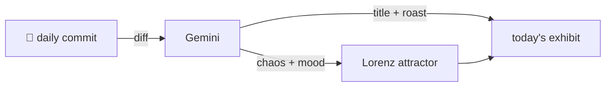

### Hey 👋

I'm Urav. I build things with code.

---

#### 📌 Featured Commit

Every day a bot grabs a commit (one of mine, someone I follow, or a stranger's), an AI names and roasts it, and it ends up as a strange attractor.

<!-- ENTROPY:START -->

### Automated Version Patrol

Chaos ░░░░░░░░░░ 5 · Mood $\color{#4a7e91}{\blacksquare}$ #4a7e91

[srbhr/Resume-Matcher](https://github.com/srbhr/Resume-Matcher) by [@srbhr](https://github.com/srbhr) · [`8c6a1b7`](https://github.com/srbhr/Resume-Matcher/commit/8c6a1b75c6f4eb2e7b9d49986dc5d0a80d5a4234)

~~~
Merge pull request #1068 from srbhr/dependabot/npm_and_yarn/apps/frontend/undici-8.12.3

build(deps): bump undici from 8.11.2 to 8.12.3 in /apps/frontend
~~~

Another day, another dependency fed by the bots. Updating a crucial HTTP client like `undici`, even if just a minor bump, is essential for stability and security. Pinning it with an override shows a prudent approach, or perhaps a scarred veteran of dependency hell.

captured 2026-10-30

<!-- ENTROPY:END -->

---

What is this?

 

A GitHub Action runs daily and picks a commit: mine if I've pushed recently, otherwise something from my network or a starred repo, and the Linux genesis commit as a last resort. Gemini gives it a name, a roast, a chaos score (0-100), and a mood color. Those become a [Lorenz attractor](https://en.wikipedia.org/wiki/Lorenz_system): chaos controls how wild the butterfly gets, mood tints the gradient, and the commit hash sets the starting point. The math is identical every run, so the commit is the only thing that changes the picture.

[See the code →](./entropy)

