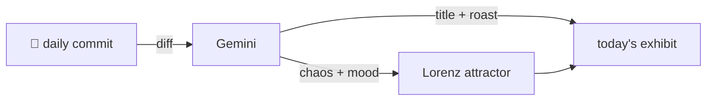

### Hey 👋

I'm Urav. I build things with code.

---

#### 📌 Featured Commit

Every day a bot grabs a commit (one of mine, someone I follow, or a stranger's), an AI names and roasts it, and it ends up as a strange attractor.

<!-- ENTROPY:START -->

### Git: Primal Commit

Chaos ███████░░░ 75 · Mood $\color{#005F7F}{\blacksquare}$ #005F7F

[torvalds/linux](https://github.com/torvalds/linux) by [@Unknown](https://github.com/Unknown) · [`1da177e`](https://github.com/torvalds/linux/commit/1da177e4c3f41524e886b7f1b8a0c1fc7321cac2)

~~~
Linux-2.6.12-rc2

Initial git repository build. I'm not bothering with the full history,
even though we have it. We can create a separate "historical" git
archive of that later if we want to, and in the meantime it's about
3.2GB when imported into gi
…
~~~

This foundational commit isn't just Linux-2.6.12-rc2; it's Git's ground zero, stripped of cumbersome history for practical velocity. Linus's pragmatic decision, 'Let it rip!', captures the moment's bold confidence. Ironically, the lingering BitKeeper docs hilariously underscore just how fresh this radical paradigm shift truly was.

captured 2026-10-25

<!-- ENTROPY:END -->

---

What is this?

 

A GitHub Action runs daily and picks a commit: mine if I've pushed recently, otherwise something from my network or a starred repo, and the Linux genesis commit as a last resort. Gemini gives it a name, a roast, a chaos score (0-100), and a mood color. Those become a [Lorenz attractor](https://en.wikipedia.org/wiki/Lorenz_system): chaos controls how wild the butterfly gets, mood tints the gradient, and the commit hash sets the starting point. The math is identical every run, so the commit is the only thing that changes the picture.

[See the code →](./entropy)

